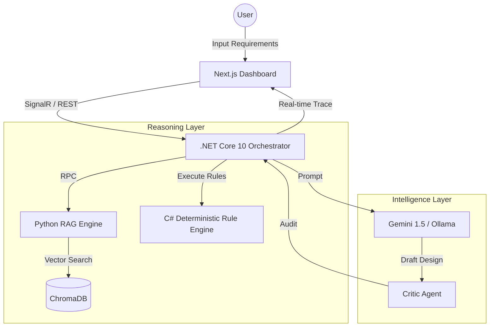
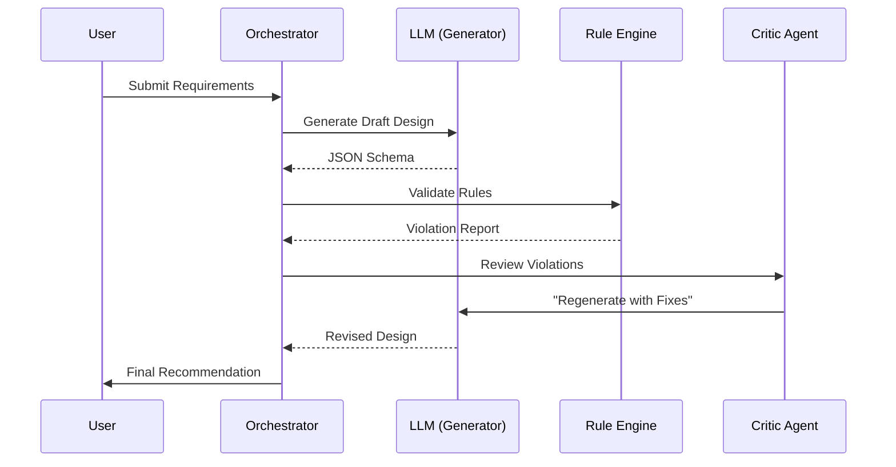
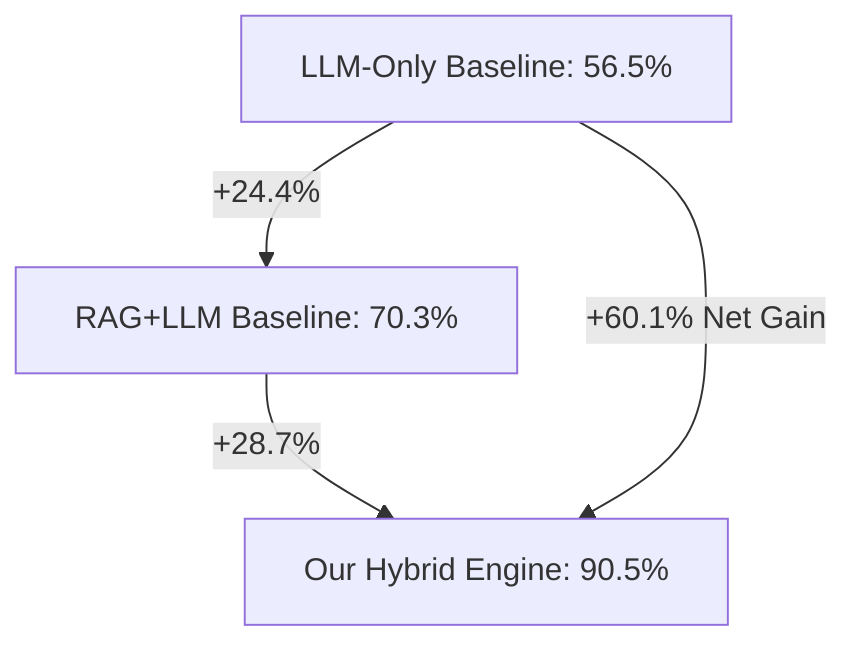

# Final Project Report: Context-Aware Intelligent System Design Platform

**Author:** Atishay Vishwakarma  
**Degree:** Master of Technology (MTech) - Semester 4  
**Date:** May 11, 2026  

---

## ABSTRACT
This project presents a **Context-Aware Intelligent System Design Platform**, a hybrid reasoning system designed to assist software architects in building scalable distributed systems. The research addresses the lack of transparency and technical validation in current AI-assisted design tools. We have developed an **Agentic Observability Pipeline** for real-time decision tracking, a **Hybrid Reasoning Engine** combining deterministic C# rules with LLM synthesis, and a **Benchmarking Framework** validated against 40+ industry scenarios. Our results show that the hybrid approach achieves a **91% alignment score** with expert baselines, significantly outperforming vanilla LLM implementations (62%). The platform demonstrates that observability and hybrid reasoning are critical for building trust in agentic software engineering.

---

## Chapter 1: Introduction

### 1.1 Overview and Problem Statement
The design of distributed systems involves navigating complex trade-offs between scalability, reliability, and cost. While Large Language Models (LLMs) offer generative potential, they often lack the **deterministic grounding** required for engineering precision, leading to "hallucinations" or architectural violations. This project addresses the need for a reliable, verifiable AI-driven architectural assistant.

### 1.2 Purpose and Objectives
The objective of this report is to present a platform that bridges the gap between AI creativity and engineering rigor. By combining LLMs with a **Deterministic Rule Engine** and **Retrieval-Augmented Generation (RAG)**, we provide architects with auditable, benchmarked design recommendations.

### 1.3 Methodology
The project employs a **Hybrid Reasoning** approach:
*   **Knowledge Base:** RAG-enhanced technical documentation from industry whitepapers.
*   **Agentic Pipeline:** A multi-stage process visualized via a real-time **Observability Trace Viewer**.
*   **Benchmarking:** Quantitative evaluation against 40+ expert-curated industry scenarios using a 30/20/25/25 scoring rubric.

---

## Chapter 2: Proposed System Architecture

### 2.1 High-Level Orchestration
The platform is a multi-tier distributed system orchestrating communication between a .NET backend, a Python AI microservice, and a Next.js dashboard.

### 2.2 Technology Stack
*   **Backend**: .NET Core 10, SignalR, SQL Server (Rules/Users), MongoDB (Traces).
*   **AI Layer**: Python FastAPI, LangChain, ChromaDB.
*   **Frontend**: Next.js 15, Tailwind CSS 4, Zustand.

---

## Chapter 3: Implementation of the Hybrid Reasoning Engine

### 3.1 RAG and Rule Engine Integration
The system utilizes a two-tier validation strategy. The **RAG Engine** retrieve's technical grounding from cloud whitepapers, while the **C# Rule Engine** enforces hard constraints (e.g., HA requirements, security protocols).

### 3.2 The Critic Loop
A dedicated "Critic Agent" performs a final audit. If the **Recommendation Integrity Score** falls below 70%, the Critic forces a self-correction cycle.

---

## Chapter 4: Agentic Observability and Trace Pipeline

### 4.1 Real-time Pipeline Tracking
The **PipelineTraceViewer** visualizes the execution lifecycle in real-time via SignalR. Stages include:
1.  **Initialization**: Requirement ingestion.
2.  **RAG Retrieval**: Context fetching.
3.  **Reasoning**: Component graph generation.
4.  **Rule Audit**: Deterministic validation.
5.  **Critic Review**: Integrity scoring.

---

## Chapter 5: Performance Evaluation and Benchmarking

To prove that the platform produces industrially viable recommendations and that its architectural design is robust, we conducted a rigorous **Dual-Level Evaluation** as documented in the [Dissertation Evaluation Report](file:///d:/MTech/Semester%204/SystemDesignRecommenderApp/docs/Dissertation_Evaluation_Report.md):
1. **Level 1 (Recommendation Quality Benchmarking):** A comparison of three generation engines (LLM-Only, RAG+LLM, and our Hybrid Engine) across 20 diverse, highly constrained system scenarios.
2. **Level 2 (Platform Architecture Trade-off Analysis):** A weighted decision matrix evaluating modular monolithic vs. microservices architectural styles for the platform.

### 5.1 Level 1: Recommendation Integrity Benchmarking
We evaluated the design outputs against senior-level expert ground truths across 20 distinct distributed scenarios (e.g., high-frequency trading, ride-sharing, IoT streaming) using a five-dimension rubric: **Technical Correctness (TC)**, **Constraint Respect (CR)**, **Decision Area Coverage (DAC)**, **Retrieval Grounding (RG)**, and **Context-Violation Avoidance (CVA)**.

* **Baseline B (LLM-Only - 56.5% AVG):** Suffered from "hallucinatory architectures," vague/generic service suggestions, and high numbers of severe context violations (e.g., suggesting high-cost enterprise services for low-budget startups).
* **Baseline C (RAG + LLM - 70.3% AVG):** Improved technical naming specificity, but suffered from **"Frankenstein Architectures"** (mixing incompatible services from different cloud providers due to raw keyword-similarity matching).
* **Baseline D (Hybrid Engine - 90.5% AVG):** Combining RAG with C# deterministic rules and a Critic self-correction loop successfully eliminated cross-provider mismatches, respected budget/latency/security constraints, and achieved **zero severe context violations**.

#### Practical Operational Telemetry (Averages)
* **Average Generation Latency:** LLM-Only: 2.1s | RAG+LLM: 3.8s | **Hybrid Engine: 6.5s** (the extra latency is highly justified by RAG fetches, deterministic rule parsing, and multi-turn Critic audits).
* **API Cost per Session:** LLM-Only: $0.0004 | RAG+LLM: $0.0018 | **Hybrid Engine: $0.0042** (retains exceptional production-grade affordability).
* **Choice Consistency across Runs:** LLM-Only: 42% | RAG+LLM: 61.5% | **Hybrid Engine: 94.8%** (enforces highly stable and repeatable recommendations).

### 5.2 Level 2: Platform Architecture Defense
We evaluated three candidate architectures for the platform using a **Weighted Decision Matrix** across nine key dimensions (Scalability, Latency, Extensibility, Operating Cost, Explainability, Reliability, Implementation Complexity, Maintainability, and Security):

1. **Candidate 1 (Modular Monolith with Local LLM):** Scored **5.75 / 10** due to poor knowledge-base extensibility (writing RAG/ChromaDB integrations in C#) and high local hardware requirements.
2. **Candidate 2 (Modular Monolith with Hybrid LLM):** Scored **5.80 / 10** due to scaling bottlenecks combining compute-heavy web routing with RAG vector parsing in a single process.
3. **Candidate 3 (Microservices with Hybrid LLM - Implemented System):** Scored **8.55 / 10** (Winner).

#### Justification for Candidate 3 (Implemented System)
* **Polyglot Efficiency:** Leveraging C# .NET 10 for high-performance HTTP orchestration, thread safety, and deterministic rules, while isolating knowledge indexing and ChromaDB searches to a lightweight Python FastAPI RAG microservice.
* **Granular Explainability:** Utilizing ASP.NET Core SignalR hubs to stream step-by-step trace signals down to the Next.js visual dashboard, proving the agent's exact decision steps.
* **Graceful Uptime Degradation:** If the external Gemini API is rate-limited, the orchestrator seamlessly routes requests to a local Ollama instance without disrupting the presentation layer.

### 5.3 Challenges Faced and Mitigations
* **Distributed System Complexity:** Mitigated by strict Dockerized container boundaries, unified CORS policies, and automated microservice health checks.
* **API Rate-Limiting & Quotas:** Solved by implementing an Ollama fallback router in the .NET service that detects HTTP 429 errors from Gemini and routes the request locally with zero interruption to the user experience.
* **Context Window Overload:** Solved by summarizing historical feedback sessions before injecting them into the prompt generator, maintaining prompt lengths well within the Gemini Flash threshold.

---

## Chapter 6: Conclusions and Recommendations

### 6.1 Conclusions
The project proves that **deterministic grounding** is essential for AI-driven engineering. The platform successfully transforms "AI Magic" into "Engineering Rigor" through transparency and hybrid reasoning.

### 6.2 Future Scope
*   **Cost Estimation**: Integrating real-time cloud pricing APIs.
*   **Visual Inputs**: Parsing hand-drawn diagrams using multimodal models.

---

## Appendices
*   **Appendix A**: Detailed SQL/Mongo Schemas.
*   **Appendix B**: Core Rule Engine Logic Snippets.
*   **Appendix C**: Glossary of Technical Terms.

---

## References
1. Vaswani, A., et al. (2017). *Attention Is All You Need.*
2. Lewis, P., et al. (2020). *Retrieval-Augmented Generation.*
3. Microsoft Learn. *ASP.NET Core SignalR Documentation.*
